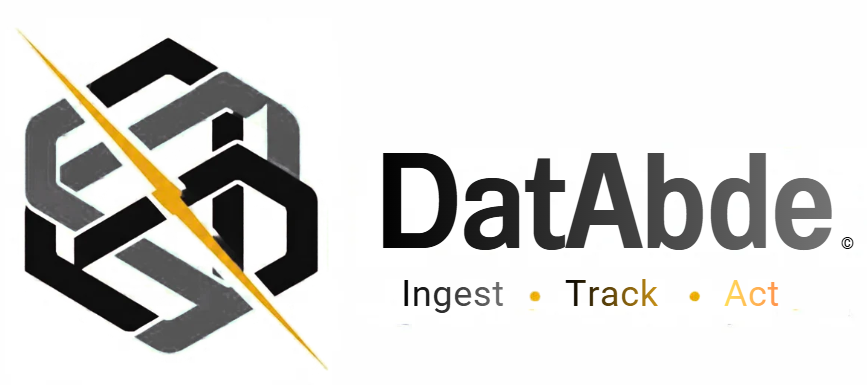

<p align="center">
  
</p>

<p align="center">
</p>

**DatAbde is an unified platform I created for data processing, analytics, and infrastructure observability.**

## Overview

DatAbde Platform is designed to collect, process, store, explore, and analyze data from multiple sources and in different formats.

It combines batch processing, real-time streaming, data exploration, ML, and infrastructure observability.

The platform separates raw data storage from data processing and search indexing. Every source lands first in object storage in its original format; only the information needed for search and visualization is converted and indexed.

## Architecture

```text
   SMALL FILES / EVENTS                         LARGE FILES
   (JSON, CSV, XML, TXT, YAML, Avro)            (Parquet, large batches)
            |                                           |
            v                                           |
          KAFKA                                         |
   Real-Time Ingestion                                  |
            |                                           |
            v                                           |
          SPARK  (batch + Structured Streaming)         |
   Distributed Data Processing                          |
            |                                           |
            +-----------------+                         |
            |                 |                         |
            v                 v                         v
     (selected info)    (raw data, in original format)  
            |                 +------> MINIO <-----------+
            |                       Object Storage       |
            v                    raw | processed | ML    |
      ELASTICSEARCH                       |   ^          |
    Search & Analytics                    |   |          |
            |                             |   +-- Spark reads back (batch, ML)
            v                             v
         KIBANA                    SQL ENGINE
   Search & Visualization                 |
                                          v
                                       SUPERSET
                                  Data Exploration
                                 & Business Analytics
```

Key flows:

- **Small files and events** go through Kafka, then Spark. Spark writes the raw data to MinIO in its original format and sends selected information to Elasticsearch.
- **Large files (Parquet)** are deposited directly in MinIO. They do not transit through Kafka (default message size limit: about 1 MB).
- **Batch processing and ML** read from MinIO with Spark and write results back to MinIO (datasets, predictions, models) and to Elasticsearch (run metrics).
- **Superset** reads MinIO datasets through a SQL engine (Spark Thrift Server), never directly.

## Technology Stack

| Technology | Purpose |
|---|---|
| Apache Kafka | Real-time data ingestion and event streaming |
| Schema Registry | Versioned schemas for Avro messages in Kafka |
| Apache Spark | Distributed data processing, transformations, and machine learning |
| Spark Thrift Server | SQL access to MinIO datasets, used by Superset |
| MinIO | Object storage for raw data, processed datasets, and ML artifacts |
| Elasticsearch | Search, indexing, and analytical queries |
| Kibana | Data exploration, dashboards, and alerting |
| Apache Superset | Interactive data exploration, charts, and business dashboards |
| OpenTelemetry | Infrastructure telemetry collection (metrics and logs) |
| Prometheus-compatible metrics | Metrics collection and monitoring |
| Grafana | Infrastructure observability dashboards |

## Multi-Format Data Processing

DatAbde Platform supports multiple data formats without converting every source into JSON before processing.

Supported formats:

- JSON
- Parquet
- Avro
- CSV
- XML
- Plain Text (TXT, logs)
- YAML

Spark reads each format natively (XML through the Spark XML data source, YAML through a lightweight parser). Raw data is always kept in its original format in MinIO. Avro and Parquet are processed natively, with no intermediate conversion.

Only the information required for search and visualization is transformed into Elasticsearch-compatible JSON documents, at the last step, when writing to Elasticsearch.

### Raw data for every format, JSON included

Every file or event lands in MinIO first, JSON included (written in micro-batches for streaming sources). Elasticsearch is an index over this data, never the only copy. This guarantees that every indexed document can be traced back to its raw source.

### Source configuration

Some formats cannot be read without parameters. Each source is described by a declarative configuration file:

| Format | Required parameters |
|---|---|
| CSV | Separator, header, encoding |
| XML | Row tag (the element that represents one record) |
| TXT / logs | Parsing pattern (regular expression) per log type |
| YAML | Root path of the records |
| All | Target index, fields to index, mapping |

Adding a new source means adding a configuration file, not writing code.

### Schemas

Avro messages in Kafka are governed by a Schema Registry. Avro and Parquet files carry their own schema. For other formats, the schema is defined in the source configuration.

### Data Traceability

Each indexed record carries a common metadata envelope:

- `record_id`: unique record identifier, computed as `hash(source_uri + source_locator)`. Two identical lines in different positions get different identifiers.
- `source_uri`: reference to the original file in MinIO.
- `source_locator`: position of the record in the file (line number, offset, or Parquet row group and row).
- `source_format`: original data format.

Together, `source_uri` and `source_locator` point to the exact record in the raw data.

## Batch and Real-Time Processing

**Batch processing**

Spark processes datasets stored in MinIO, enabling large-scale transformations, data preparation, analytical workloads, and machine learning.

**Real-time processing**

Kafka transports incoming events to Spark Structured Streaming for continuous processing. Raw events are written to MinIO and selected results are indexed in Elasticsearch.

Both modes can coexist within the same platform.

## Storage and Search

### MinIO: Object Storage

MinIO stores raw data in its original format, processed datasets, and machine learning artifacts. It holds the source of truth for every format.

### Elasticsearch: Search and Analytics

Elasticsearch indexes selected structured information that needs to be searchable or accessible through analytical dashboards. It is an index over MinIO, not a replacement for it.

Large analytical datasets (for example full Parquet tables) are not indexed in Elasticsearch. Only aggregates, samples, or catalog information are indexed; the data itself stays in MinIO.

### Kibana: Search and Visualization

Kibana provides search, data exploration, dashboards, and alerting for information indexed in Elasticsearch. Alerting helps users identify anomalies or conditions that require attention.

### Apache Superset: Data Exploration

Superset provides interactive charts and business dashboards for datasets stored in MinIO, accessed through the Spark Thrift Server. It complements Kibana by supporting analytical exploration of structured datasets, without requiring them to be indexed in Elasticsearch.

Semi-structured formats such as XML must first be flattened into tables by Spark before they can be explored in Superset.

## Machine Learning

Machine learning is an optional capability, enabled when required by a use case.

Spark can train and evaluate models, generate predictions, and produce analytical outputs.

- **Predictions:** stored as Parquet datasets in MinIO, associated with a `run_id` and a `record_id`.
- **Models:** saved in MinIO using Spark ML model persistence.
- **Run metrics:** indexed in Elasticsearch (`run_id`, date, metric, value) to support monitoring and trend analysis in Kibana.

The shared `record_id` links a prediction back to its raw record, so dashboards can move from a trend to the underlying data.

## Multi-Tenancy

To serve several customers on the same platform, resources are isolated per tenant:

- **MinIO:** one bucket (or prefix) per tenant, with its own access policy.
- **Kafka:** topics prefixed by tenant, with ACLs.
- **Elasticsearch:** indices prefixed by tenant, with role-based access.
- **Superset and Kibana:** one space or role per tenant.

Authentication and authorization are enforced at each component, with credentials managed per tenant.

## Infrastructure Observability

Infrastructure observability is independent of business data analytics.

OpenTelemetry collects infrastructure metrics and logs. Metrics are exposed in Prometheus-compatible format for time-series monitoring and displayed in Grafana. Infrastructure logs are indexed in dedicated Elasticsearch indices, separate from business data, and explored in Kibana.

Each interface has a clear purpose:

- **Kibana:** search and analysis of indexed business data and infrastructure logs.
- **Superset:** exploration and visualization of structured analytical datasets.
- **Grafana:** infrastructure health, performance, and resource monitoring.

## Design Principles

- **Format flexibility:** support multiple data formats without universal JSON conversion.
- **Raw data first:** every source lands in MinIO in its original format; Elasticsearch is only an index.
- **Separation of concerns:** distinguish ingestion, processing, storage, indexing, and visualization.
- **Efficient processing:** avoid unnecessary conversions and processing overhead.
- **Data traceability:** every indexed record points to its exact position in the original data.
- **Declarative sources:** onboarding a new source is configuration, not code.
- **Scalability:** use distributed processing and streaming for growing workloads.
- **Optional machine learning:** introduce ML according to business requirements.
- **Independent observability:** monitor platform infrastructure separately from business analytics.

## Project Status

The platform is being developed incrementally.

The existing foundation includes Elasticsearch, Kibana, and infrastructure observability components. Kafka, Spark, MinIO, Superset, the SQL engine, and their integrations form the broader architecture to be implemented and validated progressively.


## Future Vision: Agentic AI

The Agentic AI capability aims to help users understand their problems, investigate potential causes, and identify possible solutions.
It will build on the platform's data processing and analytical capabilities to support more intelligent investigation and decision-making.

---

<p align="center">
  <sub>Created by Ajouhy Abdelah</sub>
  <br>
  <sub>© 2026 DatAbde — All rights reserved.</sub>
</p>
